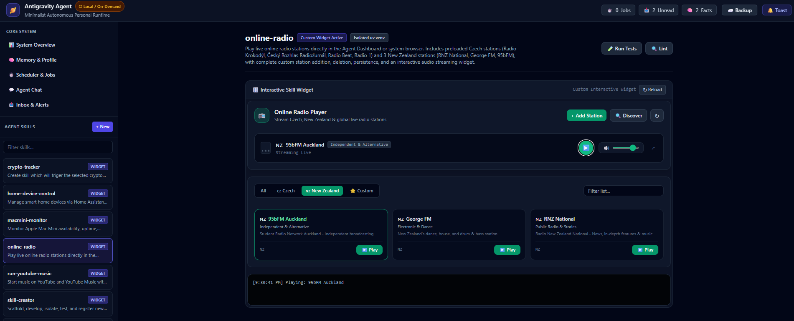

# Jarvis Antigravity Mac Mini — Autonomous Personal AI Agent

[](LICENSE)
[](https://apple.com)
[-black.svg)](https://apple.com)
[](#-100-local--private-on-apple-mac-mini-16-gb-ram)

> **A minimal, frugal, autonomous personal AI agent living natively inside Google Antigravity & Apple Silicon.**  
> Combines natural voice conversation, automatic skill widget launching and a dark-mode Web Dashboard.

---

## 📸 Interactive Web Dashboard

Experience the complete unified command center with live interactive widgets, voice & LLM chat with autonomous tool calling, background automation monitoring, memory explorer, and audio streaming:



---

## 🎙️ Voice-First Interaction + Automatic Widget Activation

Talk to Jarvis as naturally as a human. The assistant doesn't just reply with voice — **it dynamically brings your screen to life**:

* 🗣️ **Speak to Jarvis**: Ask naturally in English or Czech:
  * *"Play online radio from New Zealand"*
  * *"What is the current Bitcoin price in CZK and USD?"*
  * *"Play some Queen on YouTube Music"*
  * *"How is my Mac Mini running right now?"*
* ⚡ **Auto-Opening Skill Widgets**: As soon as a skill is executed via voice or chat, **the dashboard automatically switches to and opens that skill's custom interactive widget**. You instantly see live playback controls, real-time telemetry gauges, audio visualizers, or price charts corresponding directly to what you just said!
* 🛑 **Instant Hardware Cut-Off & Barge-in**: Equipped with a 4-second silence detector, live streaming transcript preview, and acoustic echo cancellation. You can interrupt the agent at any moment using your microphone hardware button.

---

## 🍏 100% Local & Private on Apple Mac Mini (16 GB RAM)

Turn an everyday **Apple Mac Mini (M1 / M2 / M3 / M4 with 16 GB Unified Memory)** into a 24/7 private Jarvis workstation — with **zero cloud subscriptions, zero token bills, and complete data privacy**:

* 🧠 **Local Neural Intelligence**: Connects to local quantized LLMs (e.g., `nvidia-nemotron-3.5-bolt-e4b-mlx`, `Qwen 2.5`, or `Llama 3.2`) served via LM Studio or MLX directly on Apple Silicon. Your conversations, transcripts, and private files never leave your local network.
* 🎙️ **On-Device Speech-to-Text (STT)**: Powered by `mlx-whisper` (`whisper-large-v3-turbo`) utilizing the Apple Silicon Neural Engine & GPU. Transcribes voice in real-time with near-zero latency and high accuracy.
* 🔊 **Native Neural Text-to-Speech (TTS)**: Direct macOS speech synthesis utilizing high-quality neural voices (such as `Zuzana (Premium)` for Czech or `Samantha / Ava / Zoe` for English).
* ⚡ **Extreme Token Efficiency**: High-frequency scheduled automations run as deterministic Python scripts (**0 LLM tokens**). The agent only engages the LLM when creative reasoning, synthesis, or conversation is strictly needed.

---

## 🛠️ Self-Extending Skills via Google Antigravity

Because this agent lives natively inside **Google Antigravity**, you can expand its capabilities effortlessly through natural conversation with the Antigravity agentic assistant:

### Create New Skills in Seconds:
Simply prompt Antigravity in chat:
> *"Create a new skill for tracking live stock prices with an interactive chart widget"*

Antigravity autonomously:
1. 📂 Scaffolds the skill structure in `.agents/skills/<name>/` via the built-in `skill-creator`.
2. 🐍 Writes deterministic Python execution scripts and declares dependencies in `pyproject.toml`.
3. 📦 Creates an isolated virtual environment (`envs/<name>/`) managed via `uv` so dependencies never conflict.
4. 🎨 Authors a responsive, modern HTML/Tailwind **`widget.html`** that immediately mounts into the Web Dashboard.
5. 🧪 Generates automated unit tests and lints the code against safety rules.

Once created, the new skill is immediately callable via **voice commands, agent chat, or scheduled cron automations**, and its interactive widget displays automatically!

---

## 🚀 Quick Start: Launch the Web UI

To open the interactive Web Dashboard in your browser:

```powershell
python runtime/agent.py web --open
```

* **Dashboard URL**: [http://localhost:8765](http://localhost:8765)
* **Features**: Live system vitals, **Agent Chat (LLM + live tool execution)**, long-term memory explorer, scheduled automations manager, notification inbox, and an interactive **Skills Registry** with domain-specific widgets.

---

## 💬 Interactive Agent Chat (LLM + Live Skills)

The Web Dashboard includes an interactive conversational chat window connected to your choice of LLM:

1. **Local Mac Mini (LM Studio on LAN)**: Connects to `http://192.168.1.100:1234/v1` (or your Mac Mini's LAN IP / hostname) running `nvidia-nemotron-3.5-bolt-e4b-mlx` (0 cloud token costs, 100% private).
2. **Google Gemini API**: Connects to `https://generativelanguage.googleapis.com/v1beta/openai` running `gemini-3.8-flash` (or `gemini-2.5-flash`).

### Autonomous Tool Execution in Chat:
When chatting with the assistant, it autonomously triggers skills as callable tools during conversation:
* *"Check if my Mac Mini is online and report vitals"* ➔ Calls `check_macmini` tool live.
* *"What is stored in my long-term memory about my car?"* ➔ Calls `search_memory` tool live.
* *"Send a desktop notification saying hello"* ➔ Calls `send_notification` tool.
* *"Play some Queen on YouTube Music"* ➔ Calls `execute_skill` with `run-youtube-music` (widget opens automatically!).
* *"Stream 95bFM Auckland radio"* ➔ Calls `execute_skill` with `online-radio` (radio player opens automatically!).

---

## ⏱️ Background Heartbeat (1-Minute Ticker)

To execute scheduled jobs, reminders, and health checks in the background:

* **Option A (Terminal Daemon)**:
  ```powershell
  python runtime/agent.py daemon
  ```
* **Option B (Antigravity Project-Local Sidecar)**:
  Toggle **Personal Agent Heartbeat (Local)** in the Antigravity Automations Dashboard (`sidecar://dashboard`).  
  Config location: `.agents/sidecars/agent-heartbeat/sidecar.json`.

---

## 🧩 Modular Skills & Interactive Widgets

Every skill lives under `.agents/skills/<name>/` with its own isolated virtual environment in `envs/<name>/` managed via `uv`.

| Skill | Description | Interactive Widget |
| :--- | :--- | :--- |
| **`voice-agent`** | Apple Silicon Voice AI: live audio streaming, mlx-whisper turbo STT, native neural TTS, mic cut-off | `widget.html` |
| **`macmini-monitor`** | Reachability, SSH vitals (CPU/RAM/Disk), Wake-on-LAN for local Apple Mac Mini | `widget.html` |
| **`online-radio`** | Live online radio streaming (CZ & NZ stations) with audio player controls | `widget.html` |
| **`run-youtube-music`** | YouTube & YouTube Music zero-confirmation playback & custom playlists | `widget.html` |
| **`home-device-control`**| Home Assistant REST API entity & service control, local host ping/SSH | `widget.html` |
| **`crypto-tracker`** | Real-time crypto price checks in USD & CZK with persistent tracked coins | `widget.html` |
| **`web-researcher`** | Clean article readability scraper, FTS5 searchable research notes | `widget.html` |
| **`skill-creator`** | Autonomous meta-skill to scaffold and register new skills & widgets | `widget.html` |

---

## 🍎 Mac Mini Deployment & Dual-Sync Workflow

The complete project can run natively on the **Apple Mac Mini** at:
`~/Google_Antigravity_Agent`

Both machines remain synchronized via a secure **dual-sync model**:

### Option 1: Instant Local Deploy from Windows (Recommended)
Pushes local commits directly over local SSH into the Mac Mini repository in under 2 seconds, updates the remote working tree (`receive.denyCurrentBranch updateInstead`), and verifies test health:

```powershell
# From Windows PowerShell:
.\scripts\deploy_macmini.ps1 -RunTests
```

### Option 2: Pull from GitHub on Mac Mini
If configured as a GitHub Deploy Key for `YourPureAI/Jarvis_Antigravity_MacMini`, you can update from the Mac Mini directly:

```bash
# In Mac Mini Terminal:
cd ~/Google_Antigravity_Agent
./scripts/update.sh
# or simply:
git pull origin main
```

### Running on Mac Mini:
```bash
cd ~/Google_Antigravity_Agent

# Run health doctor
python runtime/agent.py doctor

# Run full unit test suite (23 tests)
python -m unittest discover -s tests -v

# Start Web UI Dashboard
python runtime/agent.py web --port 8765 --open

# Check Voice Agent (Native Local Mode)
python runtime/agent.py run voice-agent main.py -- status
```

---

## 🛠️ CLI Cheat Sheet

All operations can be managed directly via `python runtime/agent.py <subcommand>`:

### 🧠 Long-Term Memory (SQLite FTS5)
```powershell
# Add a fact
python runtime/agent.py mem add "Workstation" "Custom PC with Windows 11 and RTX 4080" --kind device

# Add a pinned fact (promoted to always-on prompt in 90-user-profile.md)
python runtime/agent.py mem add "Mac Mini" "Apple M4 10-core 16GB at 192.168.1.100, alias macmini" --kind device --pin

# Diacritics-insensitive search
python runtime/agent.py mem search "mac mini"
```

### ⏱️ Scheduled Automations (0 LLM Tokens)
```powershell
# Desktop toast reminder in 30 minutes
python runtime/agent.py job add tea-timer --kind notify --at "+30m" --title "Timer" --message "Tea is ready"

# Recurring Python script check every 15 minutes
python runtime/agent.py job add check-mac --kind script --every 15 --skill macmini-monitor --script main.py --args-json '["status","--fail-if-down"]'

# List active jobs
python runtime/agent.py job list
```

### 🔒 Hardware-Backed Secrets Vault (Windows DPAPI)
```powershell
# Store credential securely (never logged, never committed)
python runtime/agent.py secret set HASS_TOKEN
```

### ☁️ Automated GitHub Backup & Disaster Recovery
```powershell
# Backup now (exports SQLite to .sql dumps, screens for secrets, commits & pushes)
python runtime/agent.py backup now -m "Manual sync"

# Disaster recovery: restore all DBs from SQL text dumps
python runtime/agent.py backup restore --force
```

---

## 🧪 Verification & Health Check

Run the comprehensive test suite and linters:

```powershell
# System doctor check
python runtime/agent.py doctor

# Lint all skills and rules
python runtime/agent.py skill lint

# Run all 23 unit tests
python -m unittest discover -s tests -v
```

---

## 📁 Project Structure

```text
Jarvis_Antigravity_MacMini/
├── .agents/
│   ├── hooks.json              # Antigravity lifecycle pre-tool guards & session alerts
│   ├── rules/                  # Modular rules (00-core, 10-safety, 20-skills, etc.)
│   ├── sidecars/               # Project-local background heartbeat sidecar
│   └── skills/                 # Modular skills (with isolated envs and widgets)
├── backups/                    # Clean SQL text dumps (committed to GitHub)
├── data/                       # Private SQLite DBs & DPAPI secrets vault (git-ignored)
├── envs/                       # Isolated virtual environments (managed via uv)
├── runtime/                    # Minimalist Python kernel & Web UI server
│   ├── agent.py                # Unified CLI entrypoint
│   └── web/                    # Zero-dependency Web Dashboard & REST API
└── tests/                      # Automated unit test suite
```
